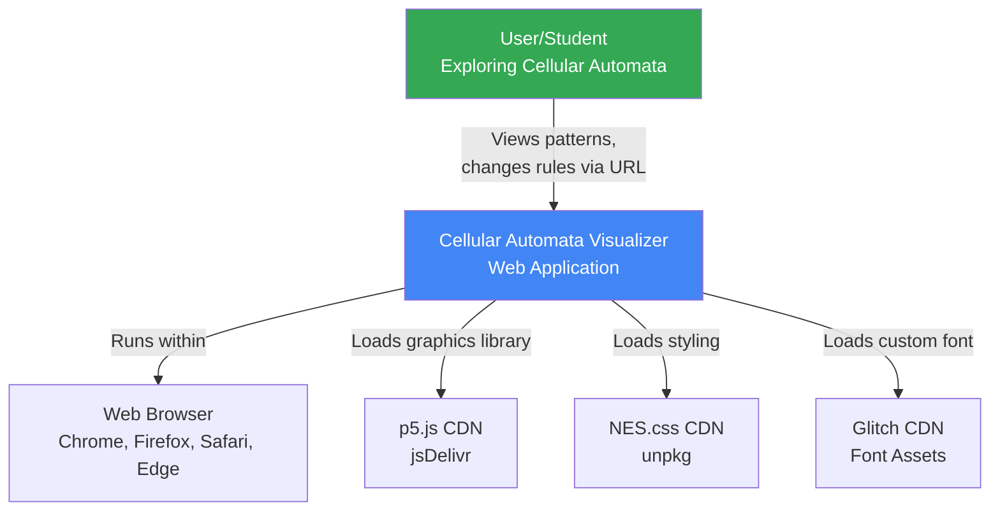
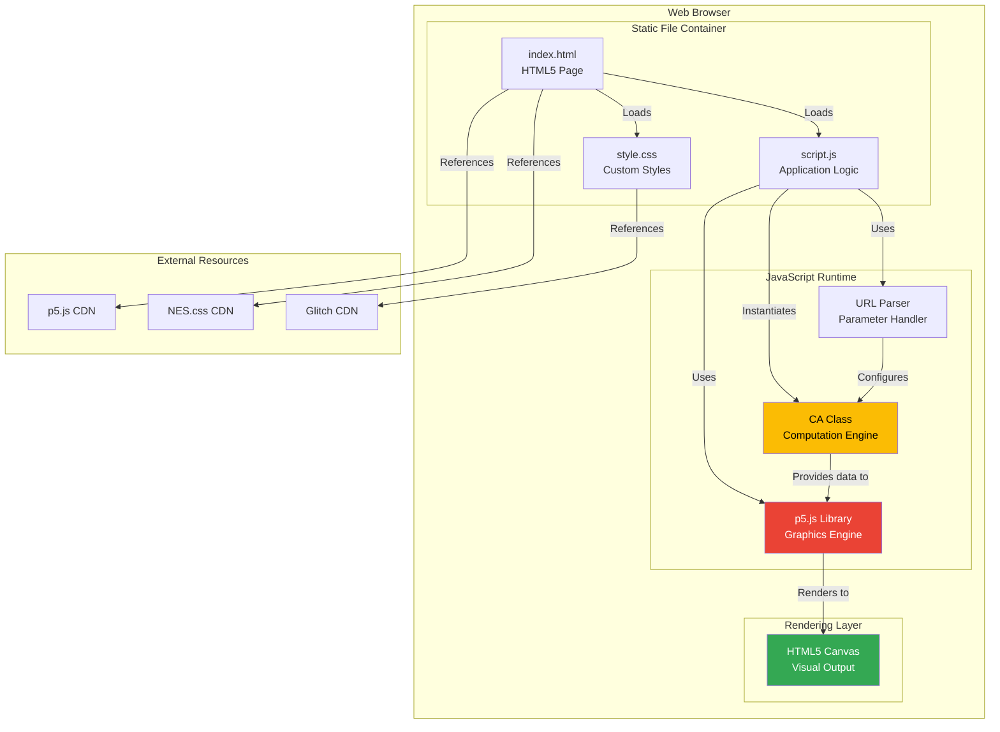
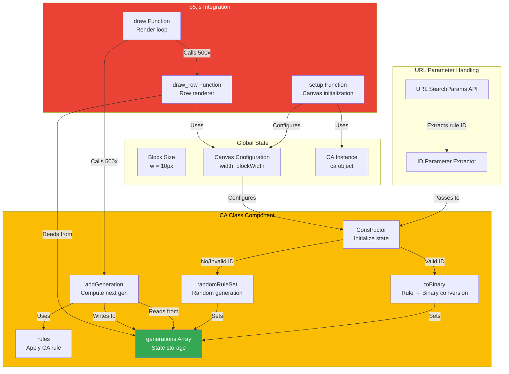
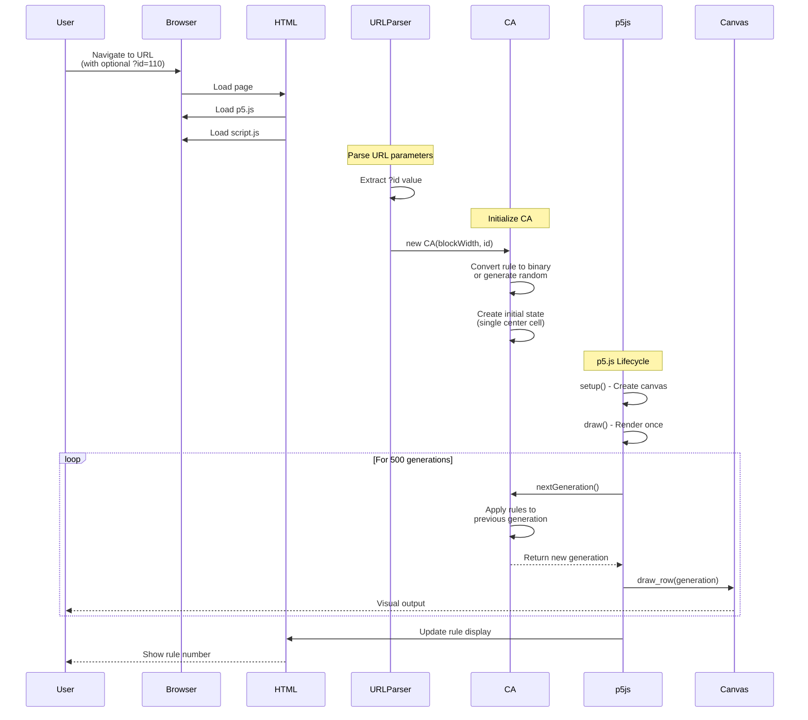
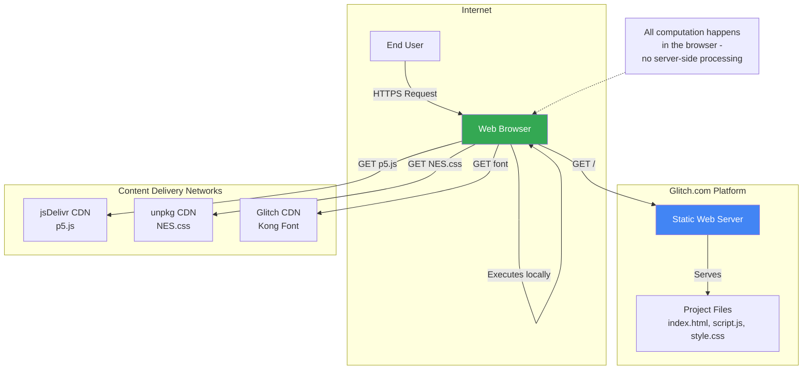
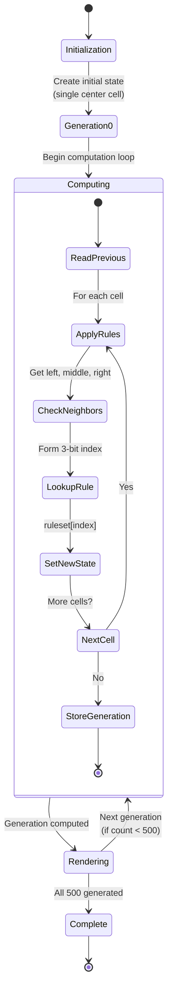

# C4 Architecture Diagrams

This document provides C4 model diagrams for the Cellular Automata Visualizer using Mermaid syntax.

## Context Diagram

The context diagram shows how the system fits into the broader environment and who uses it.

## Container Diagram

The container diagram breaks down the system into its major components and shows how they interact.

## Component Diagram

The component diagram shows the internal structure of the script.js container in detail.

## Data Flow Diagram

This diagram shows how data flows through the system from initialization to rendering.

## Deployment View

Shows how the application is deployed and accessed.

## State Transition Diagram

Shows how the cellular automata state changes over time.

## Key Architecture Decisions

### Why Client-Side Only?
- **Educational Focus**: Students can view source and experiment immediately
- **No Backend Needed**: Computation is fast enough in JavaScript
- **Easy Remixing**: Works perfectly with Glitch's instant-remix model
- **Zero Infrastructure**: No servers to maintain or scale

### Why p5.js?
- **Accessibility**: Easy for beginners to understand
- **Pedagogy**: Aligns with "Nature of Code" teaching material
- **Canvas Abstraction**: Simplifies drawing operations
- **Community**: Large educational community

### Why Array Storage?
- **Simplicity**: Easy to understand and debug
- **Pattern Analysis**: All generations available for inspection
- **Acceptable Trade-off**: 500 generations × ~140 cells = ~70KB memory
- **Future Flexibility**: Could add export or rewind features

### Why No Build Process?
- **Immediate Feedback**: Edit and refresh, no compilation
- **Lower Barrier**: No Node.js or npm knowledge required
- **Glitch Compatible**: Works with Glitch's live-editing model
- **Educational**: Source code is readable without transpilation
